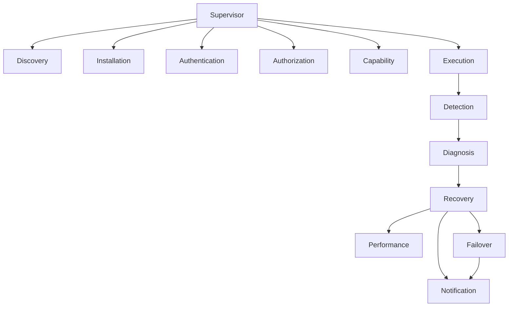

# Agent Provider 자동 복구 체계

<!-- Generated by go run ./tools/providerrecoverydesign -write-doc. Do not edit by hand. -->

SSOT: [provider-recovery.riido.json](provider-recovery.riido.json).

**상태:** design; execution environment/status slice implemented separately

## 1. 목적과 상태

Riido Daemon의 Provider 탐색·진단·복구·전환·종결에 관한 설계 기준이다. 이 문서의 전체 자동 복구 FSM은 설계이며 RIID-5820 구현 완료를 뜻하지 않는다. 관측된 장애, 추론한 원인, 선택한 조치, 실행 결과와 검증 결과를 구분한다. 프로세스 재시작·인증 갱신만으로 RECOVERED를 선언하지 않는다.

## 2. Provider와 Adapter 경계

ChatGPT API/공식 도구 연결과 Codex CLI/app-server는 별도 adapter이다. 현재 Riido의 codex provider를 임의의 ChatGPT API 연결로 해석하지 않는다. Claude Code CLI, Cursor CLI/ACP, OpenClaw gateway/channel/model 경로도 각각 별도 설치·인증·권한·프로토콜·capability 검증을 요구한다. 비지원 인터페이스는 우회 자동화하지 않는다.

## 3. 계층형 책임 구조

Supervisor → Discovery / Installation / Authentication / Authorization / Capability / Execution / Detection / Diagnosis / Recovery / Performance / Failover / Notification. 상위 supervisor는 예산·정책·종결을 소유하고 adapter는 진단 및 허용된 복구 명령만 수행한다. Event sourcing의 journal은 관측·판단·조치·검증의 provenance이며 실제 성공을 대신하지 않는다. 현재 public FSM conformance는 flat profile이다. 향후 hierarchical 실행은 별도 profile과 conformance 증거가 필요하며 기존 flat profile을 조용히 완화하지 않는다.

## 4. 장애 분류

Discovery, Installation, Version, Authentication, Authorization, Network, Availability, RateLimit, Performance, Protocol, Runtime, State, Configuration, Capability, Security, Unknown을 구분한다. 심각도는 INFO/WARNING/ERROR/CRITICAL/SECURITY이다. 장애에는 provider·adapter·phase·code·severity·retryability·user_action_required·side_effect_state·outcome_certainty·environment_revision·attempt·observed_at을 기록한다. 인증 probe의 실패/시간 초과는 인증 만료가 확정됐다는 증거가 아니다.

## 5. 복구와 검증의 안전 조건

모든 repair/retry/switch는 현재 권한·workspace/task/Agent 소유권·session binding·환경 revision·동일 실행 fencing을 재확인한다. 부작용이 발생했거나 실행 결과가 불명확하면 동일 작업을 자동 재실행하지 않는다. 원 실행을 관찰·조정하거나 사용자 확인으로 넘긴다. 다른 Provider의 native session ID는 이전하지 않는다. 새 adapter의 capability와 권한을 확인한 명시적 handoff만 허용한다. 취소는 대기·backoff·검증·전환보다 우선하며 취소 후 새 실행을 만들지 않는다.

## 6. 예산과 Circuit Breaker

정책은 최대 시도 수·누적 wall time·비용 상한·동일 장애 반복 수·Provider 전환 수·사용자 응답 기한을 모두 유한하게 고정한다. Retry-After를 존중하고 jitter를 적용하되 남은 총 기한을 넘기지 않는다. Closed→Open→HalfOpen→Closed 전이를 adapter/environment scope로 기록한다. Open 동안 새 업무 실행을 차단하며 HalfOpen의 단일 검증 권한은 원자적으로 획득한다. 실제 모델 요청은 기능·비용·권한 정책상 명시적으로 허용된 검증에서만 한다.

## 7. Provider별 정책

Claude Code: PATH/설치/권한·로그인 확인, 승인 대기와 스트림 중단을 분리하고 결과 불확실 시 재실행 금지. Cursor: CLI/ACP handshake, permission, session resume를 분리하고 새 session 생성은 정책·사용자 결정 없이 기존 맥락을 대체하지 않는다. OpenClaw: gateway, channel, model 인증, 도구 권한을 각각 진단한다. model-path probe 실패를 실제 agent 실행 실패로 단정하지 않는다. ChatGPT API: 401/403은 인증·권한 조치, 429는 Retry-After·quota 정책, 5xx/timeout은 bounded backoff·circuit 판단으로 보낸다.

## 8. 실행 환경 및 상태 계약 · RIID-5820

작업의 요청 폴더와 실제 실행 폴더, repository clone/격리 폴더/native resume, 검증 유무를 구분한다. 로컬 절대 경로·명령·credential은 호스트 설정과 로컬 IPC가 소유한다. SaaS에는 경로 원문 대신 bounded workspace kind, 검증 상태, 진단 code와 필요 조치를 전송한다. 서버·웹은 공급자의 자유 형식 오류를 원인이나 자동 재시도 허가로 추론하지 않는다. 중지·취소·시간 초과·provider 실패·host 검증 실패·세션 충돌은 구별하고 legacy 데이터는 unknown으로 표시한다.

## 9. provenance와 개인정보

journal 필드: incident_id, execution_id, attempt_id, previous/next_state, event, adapter_id, environment_revision, policy_revision, diagnostic_code, observed_at, budget_before/after, action, verification, terminal_outcome. 동일 incident/event의 재전송은 idempotent하게 반영한다. token, credential, prompt/customer 본문, 환경 원문, 로컬 절대 경로를 중앙 진단 로그에 넣지 않는다. 출력 근거는 redacted reference로 연결한다. checksum은 관측의 무결성을 돕지만 의미적 성공·계정 동일성을 보증하지 않는다.

## 10. 종결 및 작업 분담

종결은 RECOVERED 또는 DEGRADED / USER_ACTION_REQUIRED / UNAVAILABLE로 확정한다. Unknown/Security는 안전 종결·사용자 조치로 처리하고 무한 재시도하지 않는다. RIID-5816 연결 안정화, 5817 수행/호스트 검증, 5818 맥락, 5819 session/history에 이어 5820은 작업 환경·실행 상태 전달을 맡는다. 5821은 성능·품질, 5822는 Provider 자동 검증, 5823은 변경·장애 대응/복구 실행, 5824는 통합 검증이다. 이 문서의 전이 검증은 실제 adapter repair/failover 구현 또는 실모델 E2E를 증명하지 않는다.

## 11. 수용 검증

실패한 probe가 active task를 중지시키지 않는지, 늦게 온 진단이 새 run에 덮이지 않는지, 중복 event가 중복 작업을 만들지 않는지 검증한다. 권한/폴더/세션 충돌, deadline/cancel, 429/backoff, 모든 Provider 실패, UNKNOWN 결과, 복구 검증 실패, circuit half-open 경합을 각각 재현한다. 검증하지 않은 복구를 정상화로 표시하지 않는다.

## 12. 첨부 원문 범위

두 첨부 초안의 공통 목적·원칙·계층 구조·장애 분류·공통 FSM과 ChatGPT/Claude/Cursor 흐름을 반영했다. 첫 첨부는 ChatGPT 6.2, 두 번째는 Cursor 8.1 설명 도중 끝난다. OpenClaw·예산·provenance·구현 범위 상세는 위 원칙을 현재 저장소 경계에 맞춰 명시한 설계 보완이며 제공되지 않은 원문의 인용이 아니다.

## 전체 책임 구조

## 공통 장애 복구 FSM · 설계

```mermaid
stateDiagram-v2
  [*] --> OBSERVED
  OBSERVED --> CLASSIFYING: diagnose
  CLASSIFYING --> RECOVERABLE: known safe strategy
  CLASSIFYING --> USER_REQUIRED: approval or credentials required
  CLASSIFYING --> TERMINAL: security or unknown fault
  RECOVERABLE --> PRECHECK: select adapter
  PRECHECK --> REPAIRING: authorized and budget available; execution outcome known
  PRECHECK --> USER_REQUIRED: approval required
  PRECHECK --> FALLBACK: cannot repair safely
  REPAIRING --> VERIFYING: repair attempt finished; not yet recovered
  VERIFYING --> RECOVERED: required capability and execution safety verified
  VERIFYING --> BACKOFF: verification failed; retry allowed
  VERIFYING --> FALLBACK: budget exhausted or unsafe
  BACKOFF --> REPAIRING: Retry-After elapsed; circuit allows attempt
  BACKOFF --> FALLBACK: circuit open or deadline reached
  FALLBACK --> SWITCHING: compatible adapter; authority rechecked; safe handoff
  FALLBACK --> TERMINAL: no safe candidate
  SWITCHING --> VERIFYING_SWITCH: handoff fenced and checkpoint validated
  VERIFYING_SWITCH --> RECOVERED: target capability and execution safety verified
  VERIFYING_SWITCH --> TERMINAL: switch failed
  USER_REQUIRED --> WAITING_USER: notify actionable reason
  WAITING_USER --> VERIFYING: user action received before deadline
  WAITING_USER --> TERMINAL: cancel or deadline
  RECOVERED --> [*]
  TERMINAL --> [*]
```

알 수 없는 event는 `TERMINAL`로 안전하게 종결한다. 그래프의 종결 경로는 구조 검증이며 runtime의 시간·횟수 상한은 adapter 실행 구현에서 별도 증명해야 한다.
